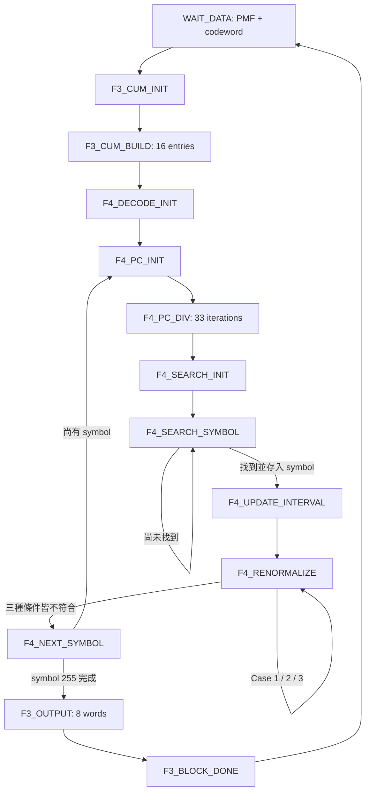

# F4 Arithmetic Decoder 實作紀錄

更新日期：2026-11-22

## 1. 實作範圍與驗證狀態

本次完成 F4 arithmetic decoding RTL：接收 PMF 與 codeword、建立 cumulative table、計算 code probability、搜尋 symbol、更新區間、renormalization，以及輸出還原資料。

- 實作：[IOTDF.v](../1151_hw4/01_RTL/IOTDF.v)。
- 官方測試平台：[testfixture.v](../1151_hw4/00_TESTBED/testfixture.v)。
- 公開輸入：[f4_in.dat](../1151_hw4/00_TESTBED/pattern1_data/f4_in.dat)。
- 官方答案：[f4_out.dat](../1151_hw4/00_TESTBED/pattern1_data/f4_out.dat)。
- 規格補充：[TA_discussion.md](TA_discussion.md)。

官方 P1 的 F4 共 2 組、16 個 output words，全部比對正確。F1、F2、F3 regression 各 64 個 output words 也全部正確。未修改官方 testbench 或測資。

目前證據是本機 Icarus RTL simulation；尚未完成 ADFP VCS、synthesis、SDF gate-level simulation、PrimeTime power analysis 或 hidden pattern 驗證。

## 2. 整個 RTL 的功能分流

`fn_sel` 在同次模擬維持不變。所有功能由 `WAIT_DATA` 接收資料，再走各自的處理路徑。

| fn_sel | 功能 | 主要流程 |
| --- | --- | --- |
| `3'd1` | F1 DES encryption | 16-byte 接收 → `LOAD_INPUT` → `INIT` → 16 次 `ROUND` → `OUTPUT`。 |
| `3'd2` | F2 DES decryption | 共用 F1 DES datapath，改用反向 key schedule。 |
| `3'd3` | F3 arithmetic encoding | 接收並統計 frequency → cumulative table → 編碼與 pending-bit 處理 → padding → 8-word 輸出。 |
| `3'd4` | F4 arithmetic decoding | 接收 PMF／codeword → cumulative table → 256 次 symbol 解碼 → 8-word 輸出。 |

F4 不使用 DES states，也不使用 F3 的 emit／pending／finalize／padding states。但它共用部分名稱仍以 `F3_` 開頭的 states；這是資源共用，不代表正在執行 F3 編碼。

## 3. F4 輸入、輸出與 Counter

### 每組資料量

| 項目 | 大小 | 意義 |
| --- | --- | --- |
| PMF | 16 bytes／128 bits | symbol 0～15 各自的 count。 |
| Codeword | 128 bytes／1024 bits | 已編碼的 bitstream，含收尾與 padding。 |
| 總輸入 | 144 bytes／1152 bits | 9 個 128-bit input words。 |
| 還原資料 | 256 個 4-bit symbols | 共 1024 bits／8 個 128-bit output words。 |

F4 的 count 已由輸入提供，不像 F3 一樣掃描原始 symbols、重新統計。TA Q19 保證單一 count 不超過 255，全部 counts 的總和為 256；因此輸入 count 可用 8 bits，但 cumulative sum 需要 9 bits。

### 資料接收位置

`f4_byte_index` 是整組輸入的 byte 位置，不是 frequency 值。它有 8 bits，表示 0～143，PMF 接收完後不歸零。

| f4_byte_index | 寫入動作 |
| --- | --- |
| 0～15 | `frequency[f4_byte_index[3:0]] <= {1'b0, iot_in}`。 |
| 16～143 | 接收 codeword，寫入共用的 `f3_input_buf`。 |

Codeword 的 buffer 定址為：

```verilog
f3_input_buf[((f4_byte_index - 8'd16) * 8) +: 8] <= iot_in;
```

例如 index 16 寫入 `[7:0]`，index 17 寫入 `[15:8]`，index 143 寫入 `[1023:1016]`。在 `in_en = 0` 的空拍，不寫入也不增加 index。

### Busy 的在途延遲

官方 TB 在 posedge 讀取更新前的 busy，再於 DEL 後送下一個 byte。停止輸入存在一個 byte 的在途延遲。

| 接收 index | RTL 動作 | TB 行為 |
| --- | --- | --- |
| 0～141 | 收取 byte，busy 維持 0。 | 繼續送資料。 |
| 142 | 收倒數第二個 byte，排定 `busy <= 1`。 | 同一 edge 仍看到舊 busy=0，送出 index 143。 |
| 143 | 接住最後一個 byte，切換至 cumulative 初始化。 | 看到 busy=1，不再送下一組。 |

因此不能等到 index 143 才拉高 busy，也不能用 `!busy && in_en` 擋掉最後的在途 byte。解碼與輸出期間 busy 維持 1，block cleanup 完成時才降為 0。

## 4. Buffers 與 Datapath 共用

| 資源 | F3 用途 | F4 用途 |
| --- | --- | --- |
| `f3_input_buf[1023:0]` | 原始待編碼 symbols。 | 輸入 codeword。 |
| `encoded_buf[1023:0]` | 編碼後 bitstream。 | 解碼還原的 symbols。 |
| `frequency[0:15]` | 接收時統計。 | 由 PMF 直接載入。 |
| `cumulative[0:16]` | 編碼累積區間。 | 解碼累積區間。 |
| `low`／`high` | 編碼區間。 | 解碼區間。 |
| 區間乘法器 | 使用待編碼 symbol。 | 使用找到的 `search_symbol`。 |
| `symbol_index` | 第幾個待編碼 symbol。 | 第幾個已還原 symbol。 |
| `output_word_index` | 輸出 encoded words。 | 輸出 decoded words。 |

`current_symbol` 用 fn_sel 選擇 F3 buffer 中的 symbol 或 F4 的 `search_symbol`。F4 額外增加 code window、code probability、下一個 bit 指標，以及循序除法器 registers。

## 5. F4 完整 State 流程



以下 cycle 數是該 state 實際執行的 posedge 次數；組合 `assign` 不自行增加 cycle。

| State | 每次 Block／Symbol 的 Cycles | 每拍做什麼 |
| --- | --- | --- |
| `WAIT_DATA` | 每 block 至少 144 個接收拍 | 每個有效 `in_en` 收一個 byte；空拍與等待下一組會增加停留時間。 |
| `F3_CUM_INIT` | 每 block 1 | 清 `cumulative[0]`，設定 cumulative index=0。 |
| `F3_CUM_BUILD` | 每 block 16 | 每拍寫一格 `cumulative[index+1] = cumulative[index] + frequency[index]`。 |
| `F4_DECODE_INIT` | 每 block 1 | 初始化 low／high、symbol index、word index，載入前 16 個 codeword bits。 |
| `F4_PC_INIT` | 每 symbol 1 | 載入除法分子、分母，清 remainder／quotient／bit counter。 |
| `F4_PC_DIV` | 每 symbol 33 | 每拍處理一個分子 bit，更新 remainder 與一個 quotient bit。 |
| `F4_SEARCH_INIT` | 每 symbol 1 | 取得完整 quotient 的低 16 bits 作為 Pc；search index=0。 |
| `F4_SEARCH_SYMBOL` | 每 symbol 1～16 | 每拍比較一個 symbol 區間；找到時寫入 decoded symbol。 |
| `F4_UPDATE_INTERVAL` | 每 symbol 1 | 用找到的 symbol 更新 low／high。 |
| `F4_RENORMALIZE` | 每 symbol k+1 | 前 k 拍執行移位與 bit 補入；最後 1 拍確認完成並離開。 |
| `F4_NEXT_SYMBOL` | 每 symbol 1 | 若 index=255，開始輸出；否則增加 index，計算下一個 Pc。 |
| `F3_OUTPUT` | 每 block 8 | 每拍輸出 128 bits，valid 連續維持 8 拍。 |
| `F3_BLOCK_DONE` | 每 block 1 | 清 frequency、重設接收 index、降低 busy，回到接收。 |

其中 k 是該 symbol 實際發生 Case 1／2／3 的總次數，依資料而變。Symbol 搜尋每次都從 0 開始；若找到的值是 s，合法輸入下搜尋恰需 s+1 拍，包括 frequency=0 的候選。

## 6. 初始化與 Codeword Bit 順序

F4 的輸入 codeword 為反向排列：第一個編碼 bit 位於輸入 bit 0。初始 code window 必須讓第一個編碼 bit 成為 code 的 MSB。

```text
編碼順序：       第 1 個 bit   第 2 個 bit   ...   第 16 個 bit
Buffer：         buf[0]        buf[1]        ...   buf[15]
Code window：    code[15]      code[14]      ...   code[0]
```

RTL 用固定 16 次的 for loop 描述 bit 對應：

```verilog
code[15 - initial_bit_index] <= f3_input_buf[initial_bit_index];
```

這是同一拍的固定接線／register 載入，不是跑 16 cycles。直接指定 `code <= f3_input_buf[15:0]` 會把 bit 方向弄反。

同一拍設定 `low=0`、`high=65535`，並將 `next_bit_index` 設為 16，因為 buffer bits 0～15 已經載入。這個 11-bit 指標可表示 1024，作為 codeword 已耗盡的位置。

## 7. Pc 計算與 33-Cycle Divider

### Fixed-point 計算

依 slides：

$$
range = high-low+1
$$

$$
P_c = \frac{code-low+1}{range}
$$

16-bit code probability 使用 fractional fixed-point：

$$
Pc_{reg} = \left\lfloor\frac{(code-low+1)\times2^{16}}{range}\right\rfloor
$$

例：low=0、high=65535、code=16383，得到 range=65536、分子距離=16384、實際 Pc=0.25，register 值為 16384，即 `16'h4000`。

### 位寬與各個 Registers

| 名稱 | 位寬 | 用途 |
| --- | --- | --- |
| `range` | 17 | 65536 無法用 16 bits 表示。 |
| `code_distance` | 17 | 保存 code-low+1。 |
| `divide_dividend` | 33 | 17-bit distance 右側接 16 個 0，乘以 65536。 |
| `divide_divisor` | 17 | 除法開始時保存 range，迭代期間不變。 |
| `divide_remainder` | 17 | 每拍保存餘數。 |
| `divide_trial` | 18 | 餘數左移，再接下一個 dividend bit。 |
| `divide_quotient` | 17 | 保存產生的商；有效作業範圍內商可由此位寬容納。 |
| `divide_bit_count` | 6 | 計數 0～32，共 33 次。 |
| `code_probability` | 16 | 下一個 state 取得商的低 16 bits。 |

### 每拍的 Restoring Division

1. 取出 dividend 的最高 bit，接到 remainder 右側，形成 trial。
2. 若 trial >= divisor，remainder=trial-divisor，本次 quotient bit=1。
3. 否則 remainder=trial，本次 quotient bit=0。
4. Dividend 與 quotient 前進一個 bit，更新 iteration counter。

分子有 33 bits，每拍處理一個 bit，因此固定 33 cycles。這是本次循序架構的選擇，不是所有除法演算法都一定需要 33 cycles。

最後一個 quotient bit 用非阻塞賦值寫入；下一拍的 `F4_SEARCH_INIT` 才讀取完整結果，避免漏掉最後一個 bit。從 `F4_PC_INIT` 到 `F4_SEARCH_INIT` 執行完，共 1+33+1=35 個 state 執行拍。

TA Q17 排除 Pc=1 等特殊邊界情況；目前依作業的 16-bit Pc 規則實作。取商低 16 bits 不是通用 arithmetic decoder 對 Pc=1 的處理方式。

## 8. 搜尋 Symbol、存放結果與區間更新

### 相同尺度的比較

Cumulative table 存的是次數，總數為 256。轉成與 Pc register 相同的尺度：

$$
Boundary_{reg} = \frac{cumulative}{256}\times65536 = cumulative\times256
$$

```verilog
symbol_lower = {cumulative[search_symbol], 8'd0};
symbol_upper = {cumulative[search_symbol + 5'd1], 8'd0};
```

兩個 boundary 都是 17 bits，才能保存最後的上界 65536。Pc 在比較前左側補 0，數值不變。

找到 symbol 的條件為 lower <= Pc < upper。上界不含等號；frequency=0 時 lower=upper，條件不成立，因此搜尋會繼續。

### 還原資料排列

```verilog
encoded_buf[(symbol_index * 4) +: 4] <= search_symbol;
```

先解出的 symbol 寫入低位。例如先解出 5，再解出 C，第一個 byte 是 `8'hC5`，不是 `8'h5C`。每個 symbol 只更新 buffer，不立即輸出 valid。

### 區間更新

共用 F3 的兩個 26-bit products：

$$
newLow = oldLow + \left\lfloor\frac{range\times cumulative[s]}{256}\right\rfloor
$$

$$
newHigh = oldLow + \left\lfloor\frac{range\times cumulative[s+1]}{256}\right\rfloor - 1
$$

除以 256 使用右移 8 bits，採 truncation／round down。Low 與 high 在同一拍更新，都使用舊 low，而不是先更新 low 再拿新 low 算 high。

## 9. Renormalization 與下一個 Bit

| Case | 條件 | 每拍動作 |
| --- | --- | --- |
| Case 1 | high < 0x8000 | Low／high 左移，low 補 0、high 補 1；code 左移並補下一個 bit。 |
| Case 2 | low >= 0x8000 | 使用與 Case 1 相同的 16-bit 移位動作，移除共同 MSB。 |
| Case 3 | low >= 0x4000 且 high < 0xC000 | 保留 bit 15、移除 bit 14，將 bits 13～0 左移，尾端補入新 bit。 |
| 完成 | 上面三種皆不符合 | 不移位、不取 bit，切換至 `F4_NEXT_SYMBOL`；此判斷本身占 1 cycle。 |

Case 1／2 的 code 更新：

```verilog
code <= {code[14:0], next_code_bit};
```

Case 3 的 code 更新：

```verilog
code <= {code[15], code[13:0], next_code_bit};
```

每次實際 renormalization 讀一個新 bit。在 `next_bit_index < 1024` 時讀取 buffer，並增加 index；到 1024 後固定補 1，指標不再增加。依 TA Q3，Case 3 也遵守耗盡後補 1。

F4 不需要 F3 的 pending counter：decoder 已有 codeword，直接更新 code window，不是重新產生編碼 bits。

即使是最後的 symbol 255，現有 RTL 仍走完區間更新、renormalization 與 `F4_NEXT_SYMBOL`，才進入輸出。

## 10. Cycle Count 如何組成

### 每個 Symbol

令 s 為該 symbol 的數值，k 為它實際 renormalization 移位次數：

$$
C_{symbol} = 1+33+1+(s+1)+1+(k+1)+1 = 39+s+k
$$

這七項依序是 PC 初始化、除法、搜尋初始化、搜尋、區間更新、renormalization、下一個 symbol 判斷。

例如解出 s=5，且發生 k=3 次 renormalization，該 symbol 共需 39+5+3=47 個 state 執行拍。這是公式示例，不是宣稱某個公開 symbol 的實測值。

### 每個 Block

假設輸入無空拍，從第一個 byte 接收，到 `F3_BLOCK_DONE` 執行完，計算 state 執行拍數：

$$
C_{block}=144+1+16+1+\sum_{j=0}^{255}(39+s_j+k_j)+8+1
$$

$$
C_{block}=10155+\sum_{j=0}^{255}s_j+\sum_{j=0}^{255}k_j
$$

144 是接收、1+16 是 cumulative 建立、1 是 decoder 初始化、8 是輸出、最後 1 是 cleanup。這是完整 block 的 state 計數公式；不是官方 TB 顯示的總模擬 cycles，也不是直接把第一個接收 edge 到最後一個 edge 的時間差除以 period。N 個連續執行 edges 的首尾時間差是 N-1 個 periods。

若中間 `in_en=0`，或等待 TB 開始送下一組，必須另外計入等待拍。TB 也包含啟動／reset、輸入握手與最終比對完成時序，所以不能直接把單一 block 公式乘以 block 數，就宣稱等於 TB 回報值。

### 官方 P1 實測總數

| 項目 | 結果 |
| --- | --- |
| F4 blocks | 2。 |
| 解碼 symbols | 512。 |
| 正確 output words | 16／16。 |
| Clock period | 6.5 ns。 |
| TB Total cost time | 166933.00 ns。 |
| TB 回報對應 cycles | 166933／6.5 = 25682。 |
| 除法迭代拍總數 | 512×33 = 16896，占回報 cycles 約 65.79%。 |

除法以外的 cycles 用於輸入、累積表、其他固定 states、symbol 搜尋、renormalization、輸出及 TB 時序；本文未另外加入 state monitor，因此不列出資料相依部分的逐 state 實測分配。

### Timeout 限制

作業 PDF 規定整次處理不可超過 1000000 cycles；原始 TB 的 `End_CYCLE` 則是 100000，實際測試更嚴格。

F4 P1 使用 25682 cycles，占 TB 上限 25.682%，兩種限制皆通過。這不是 hidden pattern 或 GLS 的保證。

| Regression 功能 | 正確 Words | TB Cycles | TB 時間（ns） |
| --- | --- | --- | --- |
| F1 | 64／64 | 2307 | 14995.50 |
| F2 | 64／64 | 2307 | 14995.50 |
| F3 | 64／64 | 26468 | 172042.00 |
| F4 | 16／16 | 25682 | 166933.00 |

四個功能分別模擬，timeout 不以四列加總判斷。

## 11. 本機重現命令

從 workspace 根目錄執行：

```sh
cd 1151_hw4/01_RTL
iverilog -g2005 -Wall -Dp1 -DF4 -Dvcd -s test \
  -o /tmp/IOTDF_F4.vvp ../00_TESTBED/testfixture.v IOTDF.v
vvp -n /tmp/IOTDF_F4.vvp -none
```

`-Dvcd` 避免 Icarus 使用不支援的 FSDB system tasks，`-none` 停用波形寫入。本機功能測試未產生可用於 power analysis 的波形，不應把這個做法視為 ADFP power 流程。

原始 F4 檔案保留 8 組資料，但官方 P1 TB 只載入前 2 組。`readmemh` 的額外 words 警告符合 TA Q8，並未修改 TB 去測全部 8 組。

## 12. 已做的資源取捨與後續工作

- F3／F4 共用 buffers、frequency／cumulative table、區間乘法器與輸出流程。
- 循序 divider 每拍重用比較／減法邏輯，不用大型單拍組合除法；仍需 synthesis 才能量測實際 area 與 timing。
- Symbol 搜尋採一個候選一拍，最多 16 拍；目前未做平行搜尋。
- 接收、計算與輸出不重疊；目前未加入 pipeline 或 clock gating。
- 尚未量測 PPA，也未依量測結果縮短 divider、調整 clock period 或減少非作用中 datapath 切換。
- Verible 仍有命名、parameter 型別、array 形式與函式 lifetime 等 style 診斷；Icarus Verilog-2005 編譯與四功能公開測資均通過。
- 下一步在 ADFP 先做 VCS RTL regression，再進行 synthesis、GLS、PrimeTime，確認 slow library、SDF 路徑與 link_library 包含 `*`，且沒有 black box 漏算功耗。